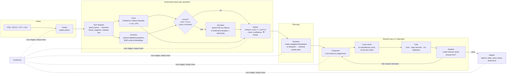

# BloomBot — demonstration guide

This guide is for presenting BloomBot. It covers:

1. what the system is and its architecture
2. how a question flows through it
3. how it was evaluated
4. a live demo script
5. answers to the questions a panel usually asks

Every number in it comes from `results/` and is explained in full in [RESULTS.md](RESULTS.md).

---

## 1. The problem in one slide

Indian colleges following Outcome-Based Education tag every exam question with a Bloom level.
AICTE's *Examination Reform Policy* (2018) gives an example cap: no more than 40% of the
marks on lower-order questions. Tagging by hand is slow and inconsistent.

Published Bloom classifiers report 0.73–0.94 accuracy. Those numbers are measured on random
splits of a **single** dataset. Train on one source and test on another, and they lose about
0.3 F1. **BloomBot is built to stay reliable on question papers it has never seen, and to
help a teacher fix an unbalanced paper.**

## 2. Architecture



The "agents" are **typed pipeline stages**, not chat agents talking freely to each other.
Each one takes and returns pydantic objects (`src/bloombot/pipeline/schemas.py`), so it can
be tested, replaced or called on its own through the API. Every step is logged as a
`TraceEvent`, so a teacher can see who decided what.

| Agent | What it is | Why this design |
|---|---|---|
| **Scribe** | line-based parser for real Indian paper layouts: Q-numbers, sub-parts, OR-alternatives, marks, CO and printed BT tags | Printed BT tags are the answer key. They are stripped before classification and kept only for comparison |
| **Lexis** | EmbedLex: parsed linguistic features + delexicalised n-grams + lexicon prior + sentence embedding → ordinal logistic regression | Best of every model tested on unseen sources; CPU-only; ~1 ms per question |
| **Archivist** | cosine nearest neighbours in 7.5k labelled questions (an institution's own examples first) | Gives the teacher concrete evidence; decides when to ask the LLM |
| **Socrates** | Qwen3-4B (4-bit, local, free) with retrieved examples, reasoning first, probabilities from token log-probs | Asked only when Lexis is unsure (about 70% of questions from an unfamiliar college, fewer on a familiar one) |
| **Arbiter** | weighted mixture of distributions | Chosen by an experiment: multiplying probabilities (the first design) lost 0.15 F1 |
| **Architect** | blueprint bound checks by marks; greedy plan with the fewest rewrites | OR-alternatives share one slot, so marks are not double-counted |
| **Composer** | LLM rewrite using the level definition, typical verbs, retrieved exemplars and the failure feedback | Offline fallback: transparent templates |
| **Level check / Critic / Student** | independent verifiers | The model that wrote a question never grades it |

## 3. What happens to one question (the NLP)

Take *"Explain how engineers evaluate the safety of an old bridge."* This is a **verb trap**:
it contains "evaluate", but the student is only asked to *explain*.

| Step | Output (real, from `POST /v1/analyze`) |
|---|---|
| Clean | numbering, marks, `CO2`, `BT4` removed; broken encoding repaired |
| Dependency parse | ROOT = **explain** (imperative); *evaluate* sits inside a subordinate clause |
| Directive | `explain` · kind `imperative` · not negated |
| Embedded Bloom verbs | `evaluate`, recorded as a trap feature, not as the task |
| Question frame | none (frames handle verb-less questions like "What if…", "Do you agree…") |
| Delexicalised text | `explain how <n> evaluate the <n> of an <adj> <n> .` (topic words masked so the model cannot learn topic shortcuts) |
| Lexicon prior (Anderson & Krathwohl) | Remember 0.10 · **Understand 0.70** · Analyze 0.15 · Evaluate 0.05 |
| Lexis (EmbedLex) | **Understand 0.51**, Analyze 0.43 → unsure → Socrates would be asked |

The other NLP pieces:

- **Compound questions.** "Define X and design Y" is scored with the *distribution of the
  maximum*: P(max ≤ k) = Π Fᵢ(k).
- **Negation.** "Do *not* derive…" removes that verb.
- **Particles and phrases.** "Come up with", "write a program" and "evaluate the integral"
  (which is Apply in mathematics) are handled as phrases.
- **Ordinal model.** The classifier is ordinal (Frank & Hall, 2001), because levels are
  ordered: calling an Evaluate question Analyze is a smaller error than calling it Remember.

## 4. How it was evaluated

**Data:** 9,855 questions from 7 public sources, each traced to its publisher, licence and
label scheme ([DATA.md](DATA.md)). The Indian school-board set (2,278 questions) is
**never used for training**.

| Protocol | The question it answers |
|---|---|
| In-domain 5-fold (paraphrases kept in one fold) | the optimistic number papers report |
| Transfer (train on 1 source, test on each other) | how big is the cross-dataset drop? |
| **Leave-one-source-out (LOSO)** | how well does it work at a *new* college? (the main number) |
| Held-out Indian boards | completely unseen Indian questions |
| k-shot adaptation (k = 0…100, 3 seeds) | how much does labelling a few of a college's own questions help? |
| Ablation | which components matter? |
| Contrast set (58 hand-written items) + CheckList tests | verb traps, negation, no-verb questions, topic-swap and format invariance |
| LLM comparison (same 418 items) + sycophancy probe | is a small LLM better? can it be talked into a wrong answer? |
| Arbiter study (nested selection) | how should the voters be combined, without cherry-picking? |
| Rewrite experiment (40 real questions) | do rewrites reach the target level and keep the topic? |

**Metrics.** Weighted F1, for comparability with prior work. Alongside it:

- macro F1, because the rare levels matter
- quadratic-weighted kappa, because levels are ordered
- within-one-level accuracy
- calibration error (ECE)

All come with bootstrap 95% CIs, and model comparisons use a paired bootstrap.

### Headline results

| Finding | Number |
|---|---|
| Cross-dataset drop reproduced (TF-IDF + SVM) | 0.732 → 0.413 (drop 0.32) |
| EmbedLex, leave-one-source-out | **0.641** wF1, QWK 0.70; +0.051 [0.041, 0.060] over TF-IDF + SVM |
| Unseen Indian boards | **0.630** [0.608, 0.649]; within one level 0.82 |
| Why the drop can't reach zero (concept shift) | "Explain…" = Understand in 93% of Gani, Remember in 55% of Indian engineering |
| 100 labelled questions from the college | mean 0.627 → 0.694; Indian boards 0.578 → 0.674 |
| Verb traps (contrast set) | POS-weighted SVM 2/10, **BloomLex/EmbedLex 9/10** |
| Small LLM alone (same items) | zero-shot 0.45, + RAG 0.51, + reasoning 0.62; EmbedLex 0.67 |
| LLM sycophancy | follows a wrong "senior teacher" hint 29–47% of the time |
| LLM as second opinion when unsure | 0.640 → **0.682** (+0.042, p = 0.01, nested) |
| Rewrites passing every automatic check | **37 / 40**, 80% first try, 4.5 s each |

Figures: `docs/figures/fig_drop.png`, `fig_concept_shift.png`, `fig_adapt.png`,
`fig_risk_coverage.png`.

## 5. Live demo script (about 10 minutes)

**Before the demo:**

```bash
source .venv/bin/activate
ollama serve &                      # if the LLM part is shown
bloombot serve --port 8000          # API + Swagger UI at http://127.0.0.1:8000/docs
```

1. **The trap** (1 min). Classify the verb trap next to an honest Evaluate question:

   ```bash
   bloombot classify "Explain how engineers evaluate the safety of an old bridge." \
                     "Evaluate whether a microkernel is a better choice than a monolithic kernel for a pacemaker."
   ```

   Point out three things. Bag-of-words models say Evaluate for both. BloomLex reads the
   directive. The first answer is unsure, so the LLM would be consulted.
2. **The parse** (1 min). Open `POST /v1/analyze` in Swagger. Show the directive, the
   embedded verb, the masked text and the prior.
3. **A real paper** (3 min). Run:

   ```bash
   bloombot paper data/papers/sample_os_paper.txt --blueprint balanced-ug --llm
   ```

   Show:
   - the parsed sub-parts, marks and OR groups
   - the level distribution by marks: 70% Remember; all three bounds fail
   - the ⚑ review flag on "Explain the difference between preemptive and non-preemptive
     scheduling". Lexis says Understand (0.81) and the LLM says Analyze (1.00); the Arbiter
     does **not** follow the overconfident LLM, it asks the teacher.
4. **Rebalance** (3 min). Run:

   ```bash
   bloombot paper data/papers/sample_os_paper.txt --blueprint balanced-ug --rebalance --llm --out results/demo
   ```

   Open `results/demo/report.md`. Four rewrites were planned and all four passed the level,
   form, topic, duplicate and student checks. The paper goes from 0 of 3 bounds met to 3 of 3.
   Show `results/demo/audit_trail.json`: every stage, with its timing. Without `--llm`, the
   rewrites fall back to transparent templates.
5. **Adaptation** (1 min). `POST /v1/profiles` with a college's labelled questions, then
   classify with that `profile_id`. "Explain…" now follows *their* convention.
6. **The evidence** (1 min). Show `GET /v1/experiments` and the four figures. Finish on the
   honest limit: about 6 in 10 exactly right at an unseen college (8–9 in 10 within one
   level). So BloomBot assists the teacher and is not meant to replace them.

## 6. Questions a panel will ask

**Why no GPU?**
Questions are about 20 tokens and the data is about 10k items. Training takes about 30 s on a
laptop CPU. The ceiling is set by *label conventions* that differ between colleges, not by
model size. A bigger fine-tuned model would just memorise its training colleges' conventions
harder.

**Why not fine-tune BERT, or LoRA an LLM?**
The same reason. The fix that actually works is adapting to each college with 25–100
labelled questions, and that takes seconds on a CPU.

**Why not use the LLM for everything?**
On the same items it is worse (0.62 vs 0.67) and 400–5000× slower. Its probabilities are
overconfident, and it changes its answer when told a "senior teacher" disagrees. It earns
its place as a reasoning second opinion on uncertain questions (+0.04) and as the rewriter.

**Isn't the contrast set biased toward your lexicon?**
Yes, for the rule baseline, and RESULTS.md says so. For the learned models it is a fair test.

**How do you know rewrites are really at the target level?**
They are re-classified by a different model from the one that wrote them, and checked for
topic and for recall-only answers. Human validation is the open next step:
`results/tables/rewrite.csv` has columns for two teacher reviewers.

**Is the data clean and legal?**
Every source is traced to its publisher, with licence and label scheme. Numeric BT codes
are refused unless their numbering scheme is known. Synthetic rows are removed from the
Indian engineering set. The CC BY-NC board set is used only for testing
([DATA.md](DATA.md)).
