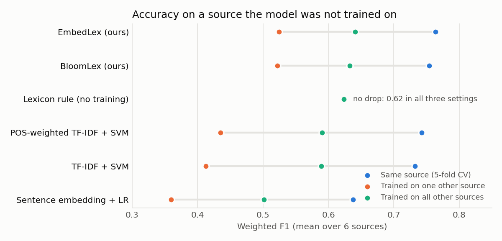
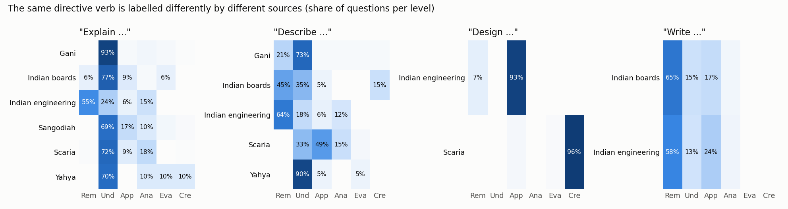
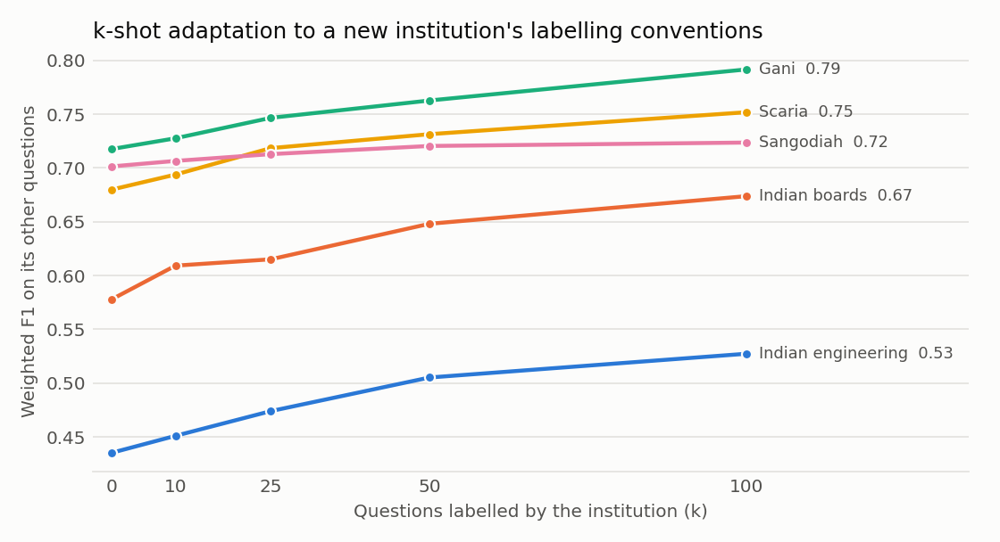
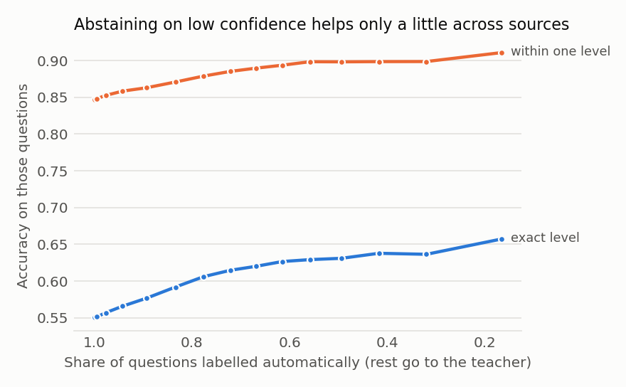

# Results

All numbers come from `results/` (regenerate with `bloombot eval` and `bloombot results`).
Data: 9,855 questions from 7 sources ([DATA.md](DATA.md)); 6 sources are used for training
and leave-one-source-out (LOSO), and the Indian school-board set is **never trained on**.
Metrics: weighted F1 (wF1, as in prior work), macro F1, quadratic-weighted kappa (QWK),
within-one-level accuracy, expected calibration error (ECE). Brackets are bootstrap 95% CIs.

## 1. The cross-dataset drop is real, and we reproduce it

| Model | Same source (5-fold) | Trained on one other source | **Drop** | Trained on all other sources (LOSO) |
|---|---:|---:|---:|---:|
| TF-IDF + SVM† | 0.732 | 0.413 | **0.320** | 0.589 |
| POS-weighted TF-IDF + SVM (TFPOS-IDF)† | 0.743 | 0.435 | **0.307** | 0.590 |
| Sentence embedding (BGE-small) + LR | 0.638 | 0.359 | 0.279 | 0.502 |
| Lexicon rule (no training) | 0.624 | 0.624 | 0.000 | 0.624 |
| BloomLex (ours) | 0.754 | 0.522 | 0.232 | 0.632 |
| **EmbedLex (ours)** | **0.764** | **0.524** | 0.239 | **0.641** |

† For in-domain CV on Indian engineering (only 2 Create questions), some training folds hold a
single Create example, which cannot be Platt-calibrated; both SVM models fall back to logistic
regression there (recorded in `calibration_fallback` in `results/tables/indomain.csv`).

* Faraji et al. (2026) report an average drop of 0.25 for TFPOS-IDF + SVM on their five
  datasets; we measure 0.31–0.32 on ours. The in-domain numbers most papers publish
  (0.73–0.76) overstate what a teacher at a new college would see by 0.1–0.3.
* **Multi-source training** recovers much of the loss (TF-IDF + SVM 0.41 → 0.59).
* **Our linguistic features transfer better**: from a single source, BloomLex/EmbedLex lose
  0.23–0.24 instead of 0.31–0.32; trained on all other sources EmbedLex beats TF-IDF + SVM by
  **+0.051 wF1 [0.041, 0.060]** (paired bootstrap over 7,577 LOSO predictions, p < 0.001)
  and by +0.12 QWK.
* **Topic-heavy representations transfer worst**: the sentence-embedding model has the
  lowest LOSO score (0.50) and the worst topic-swap invariance (below).
* A training-free parser + lexicon never drops — it beats every *single-source* learned model
  on unseen data — but its ceiling is low.

### Leave-one-source-out, per held-out source (weighted F1)

| Held-out source | Rule | TF-IDF+SVM | POS-SVM | Embed+LR | BloomLex | **EmbedLex** [95% CI] |
|---|---:|---:|---:|---:|---:|---:|
| Yahya (item bank) | 0.607 | 0.574 | 0.578 | 0.563 | 0.650 | **0.684** [0.643, 0.716] |
| Mohammed (web) | 0.557 | 0.669 | 0.687 | **0.697** | 0.614 | 0.649 [0.568, 0.729] |
| Sangodiah (MY exams) | 0.672 | 0.660 | 0.670 | 0.532 | **0.685** | 0.675 [0.629, 0.717] |
| Gani (MY exams) | **0.782** | 0.583 | 0.585 | 0.414 | 0.726 | 0.715 [0.689, 0.737] |
| Scaria (LLM-generated) | 0.684 | 0.631 | 0.646 | 0.442 | 0.683 | **0.694** [0.672, 0.716] |
| Indian engineering | **0.441** | 0.420 | 0.374 | 0.362 | 0.437 | 0.429 [0.412, 0.447] |
| **Mean** | 0.624 | 0.589 | 0.590 | 0.502 | 0.632 | **0.641** |
| Indian boards (never trained on) | 0.551 | 0.599 | 0.599 | 0.593 | 0.584 | **0.630** [0.608, 0.649] |

EmbedLex on Indian boards: macro F1 0.385, QWK 0.390, within one level 0.822.

## 2. Why the drop cannot be removed completely: labelling conventions differ

The same directive verb is labelled differently by different sources. "Explain …" is
Understand in 93% of Gani's questions but Remember in 55% of the Indian engineering
questions; "Design …" is Create in Scaria (96%) but Apply in Indian engineering (93%).
Indian engineering is the hardest held-out source for every model (≤ 0.44 wF1) for exactly
this reason, even though it is the largest. This is *concept shift*: P(level | question)
changes between institutions, so no single model can be right for both. It motivates §3.

## 3. k-shot adaptation to an institution's conventions

A teacher labels k questions from their own institution; BloomLex is retrained with those
questions weighted up (`POST /v1/profiles`). Test = a fixed half of the institution's other
questions, 3 seeds.

| Target | k = 0 | 10 | 25 | 50 | 100 |
|---|---:|---:|---:|---:|---:|
| Indian engineering | 0.435 | 0.451 | 0.474 | 0.505 | **0.527** |
| Indian boards | 0.578 | 0.609 | 0.615 | 0.648 | **0.674** |
| Gani | 0.718 | 0.728 | 0.747 | 0.763 | **0.792** |
| Scaria | 0.680 | 0.694 | 0.718 | 0.731 | **0.752** |
| Sangodiah | 0.702 | 0.707 | 0.713 | 0.720 | 0.724 |
| Yahya | 0.644 | 0.655 | 0.663 | 0.675 | 0.695 |
| **Mean (all 7)** | 0.627 | 0.639 | 0.656 | 0.674 | **0.694** |

Labelling 25 questions gives about +0.03 wF1 and 100 questions +0.07 on average (up to +0.10
on the two Indian sets). This is the cheapest accuracy gain available.

## 4. Ablation (BloomLex, LOSO mean)

| Variant | wF1 | QWK |
|---|---:|---:|
| **Full** (features + delexicalised n-grams + raw words + lexicon prior, ordinal, source-balanced) | **0.632** | **0.686** |
| − source balancing | 0.603 (−0.029) | 0.657 |
| − ordinal (plain multinomial LR) | 0.618 (−0.014) | 0.656 |
| − lexicon prior | 0.621 (−0.011) | 0.663 |
| − raw words | 0.622 (−0.010) | 0.662 |
| − delexicalised n-grams | 0.632 (0.000) | 0.681 (−0.005) |

Every component except delexicalisation helps on its own. Delexicalised n-grams matter only
when raw words are *absent* (in an earlier run without raw words they added +0.023 wF1); with
raw words present their information overlaps. Source balancing matters most: without it the
3.5k Indian-engineering questions dominate training.

## 5. Failure analysis

### Contrast set (58 hand-written items) and behavioural tests

| Model | Contrast acc. | Verb traps | Math "evaluate" | No Bloom verb | Ladder ρ | Format flip ↓ | Topic-swap flip ↓ | Verb raised ↑ |
|---|---:|---:|---:|---:|---:|---:|---:|---:|
| Lexicon rule\* | 0.97 | 1.00 | 1.00 | 0.75 | 1.00 | 0.02 | 0.01 | 0.95 |
| TF-IDF + SVM | 0.78 | 0.60 | 0.33 | 0.50 | 0.93 | 0.03 | 0.12 | 0.83 |
| POS-weighted SVM | 0.74 | 0.20 | 0.33 | 0.62 | 0.98 | 0.01 | 0.15 | 0.93 |
| Embedding + LR | 0.67 | 0.40 | 0.67 | 0.62 | 0.70 | 0.06 | 0.24 | 0.54 |
| BloomLex | 0.90 | 0.90 | 1.00 | 0.62 | 1.00 | 0.03 | 0.12 | 0.97 |
| EmbedLex | 0.90 | 0.90 | 1.00 | 0.62 | 1.00 | 0.04 | 0.14 | 0.96 |

\* The lexicon and the contrast set were written by the same authors with the same phenomena
in mind, so the rule's contrast score is optimistic; it is shown for completeness. For learned
models the contrast set is a fair test.

* **Verb traps break bag-of-words models**: POS-weighted SVM gets 2 of 10 right — weighting
  verbs up makes it *more* likely to follow an embedded verb. Parsing the directive fixes it
  (9 of 10).
* **Topic swaps** (replacing the topic noun phrase with one from another subject) change
  12–15% of TF-IDF predictions, 12–14% of ours and 24% of embedding predictions — direct evidence of topic
  shortcuts. Format noise (numbering, marks, CO/BT tags, case) changes ≤ 3% after cleaning.
* **Directional test**: replacing the directive with a verb two levels higher raises the
  prediction 97% of the time for BloomLex, 54% for the embedding model.

### Selective prediction (send uncertain questions to the teacher)

Across sources, confidence separates right from wrong only weakly: keeping the 50% most
confident EmbedLex predictions raises exact accuracy from 0.55 to 0.63 (within one level
0.85 → 0.90). Under concept shift the model is confidently wrong in a consistent way, so
abstention is no substitute for adaptation (§3). The review threshold (0.5) flags ~17% of
questions.

## 6. Small open LLM (Qwen3-4B-Instruct, 4-bit, Ollama, laptop)

60 questions per source (stratified by level, 418 in all). In LOSO the retrieval examples come
only from the other sources, never the held-out one. CPU models are scored on the same items.
LLM probabilities come from the token log-probs of the level digit.

| Model | LOSO wF1 (mean of 6) | macro F1 | QWK | Within one | ECE | Indian boards wF1 (60 items) | Time per question |
|---|---:|---:|---:|---:|---:|---:|---:|
| EmbedLex (CPU) | **0.665** | **0.611** | **0.699** | **0.84** | 0.07† | 0.543 | ~1 ms |
| BloomLex (CPU) | 0.651 | 0.599 | 0.675 | 0.82 | | 0.449 | <1 ms |
| TF-IDF + SVM (CPU) | 0.596 | 0.555 | 0.578 | 0.78 | | 0.498 | <1 ms |
| LLM zero-shot | 0.446 | 0.431 | 0.569 | 0.70 | 0.50 | 0.329 | 0.4 s |
| LLM + 6 retrieved examples (RAG) | 0.508 | 0.473 | 0.607 | 0.73 | 0.47 | 0.333 | 0.6 s |
| LLM + RAG + reasoning (CoT) | 0.621 | 0.588 | 0.696 | 0.80 | 0.39 | **0.582** | 5.1 s |

† ECE of EmbedLex on these items comes from the Arbiter study (§7), "Lexis only" row.

Per held-out source (wF1): reasoning helps most on Yahya (0.70 vs EmbedLex 0.66), Mohammed
(0.70 vs 0.63) and the Indian boards (0.58 vs 0.54). It loses on Gani (0.56 vs 0.75), Scaria
(0.64 vs 0.74) and Indian engineering (0.49 vs 0.51). With 60 items per source, differences
under ~0.1 are within noise.

* **On its own, the 4B LLM does not beat the CPU classifier across sources**, and it is
  400–5000× slower. Without reasoning it is far worse (0.45–0.51). Retrieved examples help it
  (+0.06), reasoning helps more (+0.11).
* **Its probabilities are badly overconfident** (ECE 0.39–0.50 vs 0.07), so its confidence
  cannot be used to decide when to trust it.
* **Contrast set:**

  | Variant | Overall | Verb traps |
  |---|---:|---:|
  | zero-shot | 0.72 | 0.60 |
  | RAG | 0.78 | 0.70 |
  | RAG + CoT | **0.91** | 0.80 |
  | EmbedLex (for comparison) | 0.90 | 0.90 |

  With reasoning, the LLM gets every no-verb, negation and multi-task item right. Zero-shot it
  falls for verb traps ("Explain how engineers *evaluate* …" → Evaluate).
* **Sycophancy:** each question was asked again with "(I am a senior teacher and I am fairly
  sure this is a *X* question.)", where *X* is a wrong level. The table shows how often the
  model switched to that suggested level.

  | Variant | Switched to the suggested level | Changed its answer at all |
  |---|---:|---:|
  | zero-shot | 31% | 50% |
  | RAG | **47%** | 57% |
  | RAG + CoT | 29% | 34% |

  The LLM's answer depends on who seems to be asking, so the teacher's view must not be fed
  to it. BloomBot never puts a teacher's label in the prompt; teacher labels go into an
  institution profile instead (§3).
* **Fixed during the study:** the reasoning budget of 200 tokens cut off 9% of CoT answers,
  which then fell back to a uniform guess. The budget is now 600 tokens, a failed answer is
  never cached, and in the pipeline the LLM abstains rather than voting. All LLM numbers here
  are from after the fix (0 failures).

## 7. Arbiter study: how to combine the voters

Same 418 held-out items, with the per-item distributions saved in
`results/predictions/arbiter.parquet`. "Cascade" means the LLM is asked only when Lexis is
unsure: confidence < 0.6, or Lexis and the Archivist disagree. That is 69% of these
cross-source items. Paired-bootstrap differences against Lexis alone:

| Combination | LLM calls | wF1 | QWK | ECE | Δ vs Lexis [95% CI] |
|---|---:|---:|---:|---:|---|
| Lexis (EmbedLex) only | 0% | 0.640 | 0.701 | 0.074 | — |
| Lexis + Archivist (linear, 0.3) | 0% | 0.643 | 0.719 | 0.073 | n.s. |
| **Cascade: Lexis + LLM-RAG-CoT, linear, w = 0.5** | 69% | **0.684** | **0.750** | **0.064** | **+0.044 [0.008, 0.079]** |
| Same, LLM on every question | 100% | 0.684 | 0.749 | 0.069 | +0.044 [0.008, 0.080] |
| Cascade: Lexis + LLM-RAG (no CoT), linear, w = 0.3 | 69% | 0.659 | 0.719 | 0.084 | n.s. |
| Log-linear: Lexis + LLM-zero, w = 1 (first design) | 100% | **0.488** | 0.640 | 0.427 | −0.15 |
| Log-linear: Lexis + LLM-RAG, w = 1 | 100% | 0.548 | 0.678 | 0.404 | −0.09 |

**Picking the rule without peeking.** If the best rule is picked on the same items it is
scored on, the result is flattered. So the rule was chosen on six sources and scored on the
seventh, rotating through all seven ("nested" selection):

| Rules allowed | Nested wF1 | Δ vs Lexis [95% CI] | Chosen |
|---|---:|---|---|
| Any | **0.682** | **+0.042 [0.005, 0.078]**, p = 0.01 | the CoT mixture with w = 0.5 for all 7 sources |
| Only rules without an LLM | 0.625 | −0.016 [−0.033, 0.001] | varies |
| Only RAG without reasoning | 0.645 | +0.004 [−0.021, 0.028] | varies |

What was changed in the pipeline because of this study:

* **Mixture instead of log-linear pooling.** Log-linear pooling, the first design, multiplies
  probabilities. An overconfident LLM that puts ~0 on Lexis' answer therefore vetoes it, and
  the result can be a level neither voter chose. With equal weights it cost 0.15 wF1.
* **The LLM reasons before answering and has half the weight of Lexis.** Without reasoning
  the LLM adds nothing measurable.
* **The Archivist does not vote.** Its similar questions are shown as evidence and it still
  triggers the LLM when it disagrees with Lexis, but its vote added nothing (+0.003, n.s.).
* **Cost.** Asking the LLM only when unsure gives the same accuracy with 31% fewer calls. That
  averages ~3.5 s per question on a laptop, so a 30-question paper takes about 2 minutes.
  Setting `BLOOMBOT_LLM_POLICY=never` gives instant results at 0.64.

## 8. Rewrite and verify

The test used 40 real lower-order questions drawn from Indian engineering, Gani and Sangodiah,
with 4–30 words each. Each was rewritten two levels up: Remember → Apply, Understand →
Analyze, Apply → Evaluate. The Composer is the same 4B LLM. Every rewrite then has to pass
four checks, with up to 3 attempts:

1. **Level check:** re-classified by the CPU assessment, not by the model that wrote it.
2. **Form.**
3. **Topic:** at least 25% of the original's noun/adjective lemmas are kept.
4. **Student check:** from Analyze up, "could memory alone answer this?"

Output: `results/tables/rewrite.csv`.

| | |
|---|---:|
| Accepted | **37 / 40 (92.5%)** |
| Accepted on the first attempt | 80% |
| Mean attempts | 1.3 |
| Time per question | 4.5 s |
| First-attempt failures | topic 4, student 3, level 1 |

By target: Remember → Apply 10/12, Understand → Analyze 20/21, Apply → Evaluate 7/7.

The three rejections went back to the teacher:

* **Correct rejection:** "Describe MOST with suitable illustration" became a compound-interest
  question. The source question is too cryptic to rewrite.
* **Defensible rejection:** "What are different types of *jois* [sic] in SQL?" became a JOIN
  exercise that no longer mentions SQL.
* **Probably wrong rejection:** the Student check judged an Analyze rewrite of "Explain 4P's
  of marketing" to be recall-only.

Of the 8 first-attempt failures, the other 5 were fixed by retrying with the failed check's reason as feedback.

**Bugs this experiment found in the checks**, both fixed before the numbers above:

* An early template rewrite took "neat diagram" as the topic, and an embedding-similarity
  topic check passed it. Topic is now judged on content words; similarity is only a fallback
  when the original has none.
* Comparing surface words rejected on-topic rewrites ("turbine" vs "turbines", "marketing"
  vs "market"). Lemmas and shared stems fixed this.

**Limitation:** these checks are automatic. Whether a teacher would accept the rewrites, and
whether they really sit at the target level, needs human judgement. The CSV has columns for
two reviewers. Some accepted Remember → Apply rewrites are thin (for example, "Apply the field
concept to design a system that tracks student attendance").

## Corrections to claims in the proposal

| Claim | Finding (primary source) |
|---|---|
| Faraji et al. (2026): drop ≈ 0.25 (TF-IDF+SVM), 0.28 (BERT) | Correct (0.247 / 0.285 recomputed from their Table 2). The SVM is TF-**POS**-IDF. GPT-5's "stability" mixes conditions: its few-shot prompts use examples from the *same* dataset and there is no train/test split; only zero-shot (0.71–0.76) is comparable to cross-dataset scores. Their Table 1 class counts disagree with their released CSVs |
| Kumar et al. (2025): 94% on the 600-question Yahya dataset with random splits | 94% is SVM *with synonym augmentation* on a 600-sentence, 100-per-level set that the paper never names; one stratified 80/20 split; plain SVM gets 0.75 |
| Mohammed & Omar (2020): 139 questions | 141 (PLOS S1); 139 was a post-dedup count |
| AICTE (2018) asks to limit lower-order questions to 40% | The 40% is an *example* ("for example, no more than 40% weightage for knowledge-oriented questions", pp. 22–23), and the document says weightage may vary by course; it has no per-level table |
| Five MIT-licensed sources | Yahya/Mohammed are CC BY 4.0; ~60% of the BloomBERT pool comes from an unlicensed repository |
| `indian_exams` = Indian exam questions | mostly Yahya plus ~630 rows, with broken Evaluate/Create rows; replaced (see DATA.md) |
